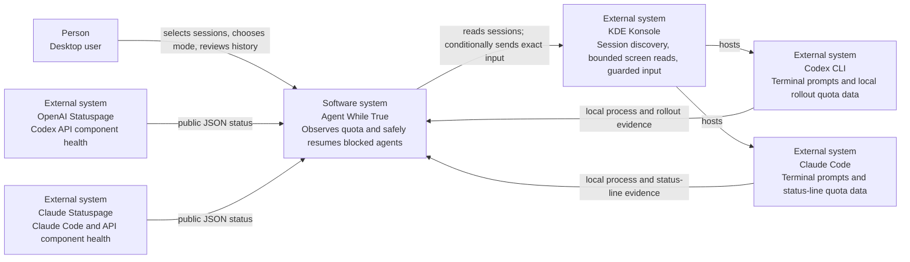
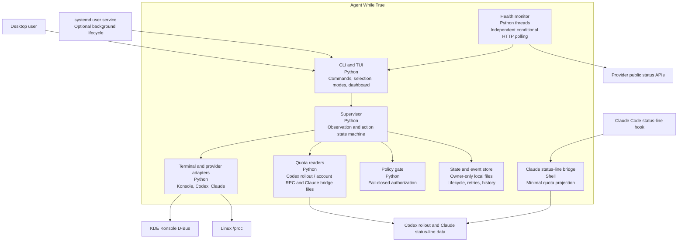
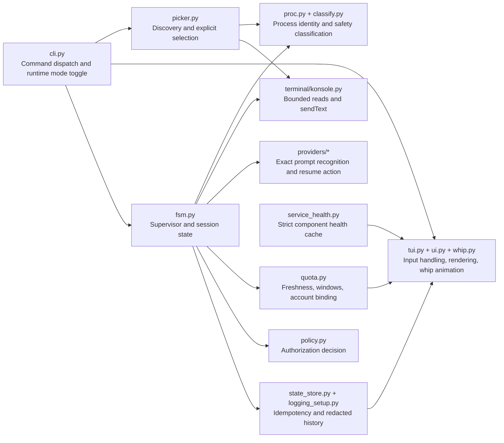
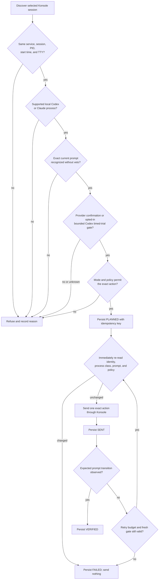
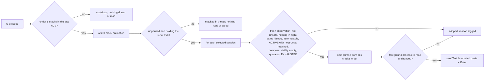
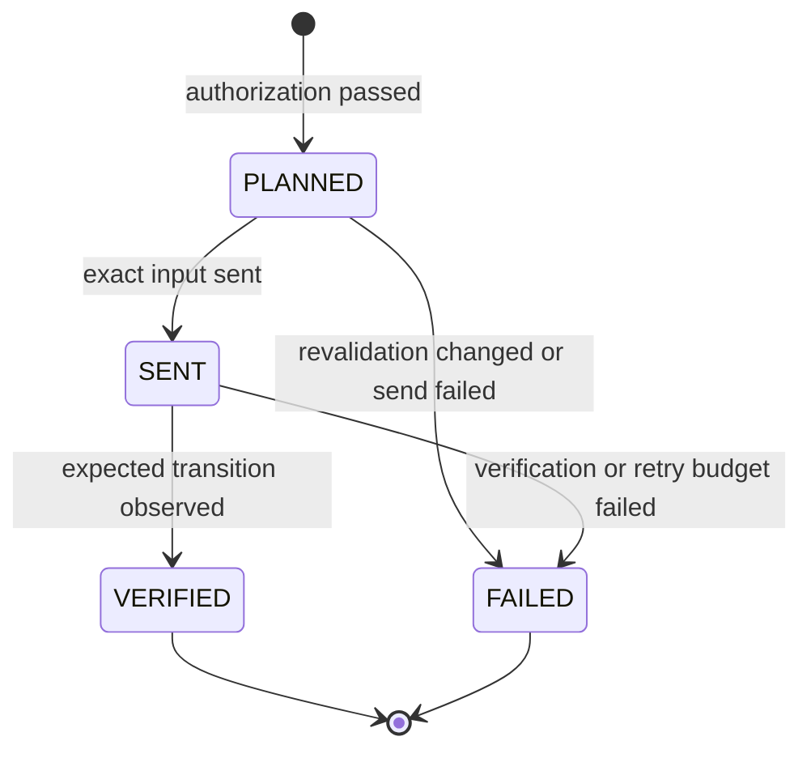
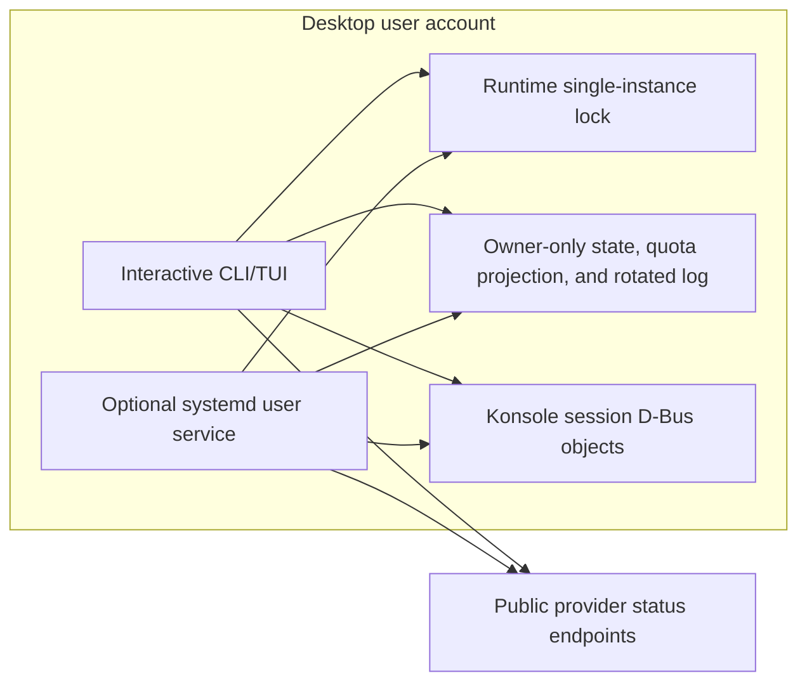

<!--
SPDX-FileCopyrightText: 2026 Marcel Petrick

SPDX-License-Identifier: GPL-3.0-or-later
-->

# Agent While True architecture

This document describes the implemented architecture. It uses the C4 model to
move from the surrounding systems to the runtime components, followed by the
safety-critical action flow. The diagrams use standard Mermaid flowcharts so
they render on GitHub without a C4-specific plugin.

## System context

Codex model-capacity recovery is a separate terminal state, not a quota episode.
Its exact screen proposes same-model `continue`; full-auto policy requires fresh
available quota and the normal final identity/prompt checks. A durable
`capacity-` process/session key retains spent attempts even after success or
record expiry. Two working observations at least three seconds apart verify
recovery. Only the watcher that sent the action credits its capacity counter;
the total combines initial permissions and verified budget/capacity recoveries.

Agent While True does not call paid model APIs. Provider quota, public service
health, and terminal prompt state are separate evidence sources.
OpenAI health reads `/api/v2/components.json`: its summary endpoint omits
grouped Codex components. The exact Codex API identity is required; unrelated
API, desktop or aggregate health never substitutes for it. No single
source authorizes input by itself.

## Containers

The runtime package has no third-party dependencies. Shell is limited to the
Claude bridge, installation helpers, and quality/release integration.

### Python runtime decision

CPython 3.14.x is the sole supported runtime. This is an intentional product
decision for the rolling-release Arch/Manjaro target, not an accidental minimum:
package metadata accepts `>=3.14,<3.15`, direct source imports reject every
other minor, and Ruff, mypy, local checks, GitHub Actions, release builds and the
container all use 3.14. Supporting another Python minor requires a deliberate
decision and its own verified migration; compatibility branches and a legacy CI
matrix are not carried in the meantime.

The published GHCR image sits outside this runtime trust boundary. It contains
the verified wheel but exposes only the deterministic simulation, version and
help commands through a restrictive non-root entrypoint. It has no qdbus,
provider CLI, host namespace, socket or credential integration, and therefore
has no path to `KonsoleAdapter.send_text`. Container classification remains the
second fail-closed boundary if an operator overrides the entrypoint. Real
supervision runs only as the desktop user on the KDE host.

Presentation preferences live in a separate, versioned owner-only file and
can restore only theme, history length and panel visibility. The detail panel
reads cached decision/observation metadata; it never evaluates authorization.
Responsive rendering and viewport navigation operate solely on presentation.
The screenshot-redaction toggle masks account e-mails at every rendering site,
never changes supervision identity, and is deliberately excluded from saved
preferences so a later run cannot silently inherit its privacy display state.
Persisted presentation fields are merged under an owner-only file lock and
atomically replaced. This prevents concurrent observe dashboards from losing
unrelated updates; transient failures remain dirty and are retried on shutdown.

`metrics.py` batches intervals between consecutive known observations, excluding
pauses and gaps. `summary.py` streams retained structured logs, including rotated
backups, to report event counts and sampled session-time. Both are independent
of the persisted action lifecycle; reports explicitly describe partial coverage.

Every structured event is tagged at emission with the watcher's PID and loaded
package version (`controller_pid`, `controller_version`); these fields describe
the emitter even when it is an observer. After scans and dashboard state
changes, a metadata-only `approval_status` snapshot correlates the session and
process with exact-menu recognition, auto-yes, mode, pause and input ownership.
Unchanged snapshots are suppressed, and a clearing transition is emitted once.
The cached reason is shown in details and is never an authorization source.

`activity.RunActivity` belongs to one `Supervisor` and starts at zero. Only
successful local sends count initial permission answers or attempts. Verification
credits restarts or armed waits only when the pending action key matches this
watcher's in-memory sent key. Restored actions, observers and Claude resends do
not inflate these outcomes. Rescans and mode changes retain the process-local
totals; exit discards them. No log replay or persistence feeds this scorecard.
`event_display` translates metadata for dashboard history and `logs`; stored
event schema and `logs --raw` stay unchanged. Its bounded activity tail hides
routine supervision-interval sampling from the feed, never from disk or summary.
Neither display path authorizes
input or changes quota state.

## Runtime components

The abstractions in `terminal/base.py` and `providers/base.py` keep terminal
transport separate from provider-specific prompts. Deterministic fake-terminal
tests exercise the same supervisor and policy paths as the Konsole adapter.

Claude's status-line bridge hashes the stable Claude session identifier and
writes one owner-only quota document per session. The document also carries the
Claude PID and kernel process start time captured from the status-line parent;
`quota.py` requires both to match the selected process. The installer requests
a 60-second status-line refresh while preserving existing status-line options,
preventing idle quota evidence from silently crossing the 15-minute freshness
limit. A legacy unbound file may be displayed only when no process is supplied
and can never authorize an action for a selected session.

## Guarded resume flow

Observe mode never reaches `PLANNED` or `sendText`. Unknown/stale quota remains
unknown/stale; it does not become available. The sole trial exception is the
owner-requested exact Codex limit composer after an anchored reset, with the
explicit Codex opt-in, persistent episode budget and no fresh contradictory
limit. Claude and other actions still require provider confirmation.

Waiting gates actions, not observations. Each normal scan updates displayed
state; action/verification deadlines can wake the loop sooner. Codex reset
anchors are bound to the selected process and reset hint; a later reset creates
a separate episode. All open same-profile rollouts are considered for quota,
using newest valid windowed evidence rather than file-descriptor order.
Discovery reads child lists from the main thread and up to 255 worker threads
per process, with a 64-process traversal cap. Linux assigns children to their
spawning thread; inspecting only the leader misses Codex's rollout writers.
Profile filtering still applies to every discovered process and rollout.

If the selected Codex process has no rollout descriptor, `CodexRolloutSource`
delegates to `CodexDaemonSource`, not a guessed shared daemon rollout. The source
binds PID/start time, process `CODEX_HOME` and the opaque account hash from the
owner-private auth file before and after reading. Its bounded LRU cache retains
the actual observation time (60-second successes, 10-second failures), and every
cache hit revalidates that binding. No raw account or environment value is logged.
`codex_rpc` starts only `codex app-server proxy` against the existing local
daemon and speaks its WebSocket transport over pipes. Its only application RPCs
are initialize/initialized and `account/rateLimits/read`; initialization requests
explicit OAuth so it cannot launch an automatic sign-in flow. The five-second,
512-KiB, 64-frame read cleans up only its own proxy. It never opens a thread,
submits a turn or changes provider settings. Every returned window/bucket is
validated conservatively, the response account must match, and ordinary usage
must be explicitly allowed. Missing permission or unsupported caps are UNKNOWN;
an explicit denial, exhausted window or spending-control block is EXHAUSTED.
Reset clocks never turn either state into AVAILABLE.

## Auto-yes

A permission prompt is the `APPROVAL_PENDING` state and never a resume prompt:
`policy.evaluate` refuses it in every mode. The dashboard's `y` switch is the
only way it is answered. After each scan with the switch on,
`Supervisor.approve_pending` offers every session whose last observation was
an exact permission menu to `Supervisor.approve`, which refuses observe and ask
mode, an unsafe session, an unsupported provider or an action in flight, re-observes the
session, requires that provider's `tool-approval` as the only match with the exact
shape and the same box fingerprint, re-reads the foreground process last and
sends a single Enter. The answered fingerprint is held in memory until a scan
sees no permission prompt, so a slow redraw cannot take a second Enter. The one
exception is a dropped Claude keypress: when the identical Claude box is still
there `APPROVAL_RECHECK_SECONDS` (3 s) after its answer, `approve_pending`
offers it to `approve` once more through the same gate (`approval_sent
reason=resent`). A box that outlives that Enter too is reported once as
`unanswered-after-resend` and left to the operator. Codex never gets this
second Enter: its unchanged overlay is reported as `unanswered-no-resend`
because a delayed key could land on a consequential next modal. Toggling `y`
does not reset either state, and nothing about it is persisted.

## Operator whip

The dashboard's `w` key is the one input path an operator starts by hand. It
is deliberately outside the resume lifecycle: a crack is a single attempt per
session and is never planned, persisted or retried, so a restart cannot repeat
it. It still passes its own revalidating gate in `Supervisor.whip`:

"Composer visibly empty" is provider-specific: Codex's composer row holds
nothing but its placeholder and only exact footer chrome follows, including
the anchored current `model reasoning · directory` status row when no context
percentage is shown; Claude's empty cursor row must sit directly on its input
box's closing rule, so a multi-line draft begun with Shift+Enter is skipped
too. The background-agent panel Claude Code
2.1.292 draws under its status lines while subagents run (a `main` row, then
one row per agent) is cut as chrome first; any other row there fails closed.
For prompt recognition, the panel-trimmed candidate is accepted only when it
contains a recognized self-healing wait and proposes no action. All actionable
menu/reset recognition keeps the original latest-turn scope: panel-like
assistant prose must never expose a historical action. Composer and permission
checks still use the original full screen. Verification of a self-healing footer records
`armed-provider-wait`, retains the limit sighting and never claims that quota
has returned, even when the footer also offers paid credits.
Quota is used the other way round from a
resume: exhausted quota blocks a crack, while unknown quota does not, because a
reminder asks for no usage that is not already being spent. Each crack offers
all fifty phrases in an order that puts recently delivered ones last, so every
session reached gets a different line. The log records the phrase index, never
its text.

## Persisted action lifecycle

The state store prevents replay of unsettled action keys. Bounded Codex retries
use a persistent session/process/reset episode and a separately reserved action
key for each attempt, so a changed screen fingerprint cannot replenish budget.
Episode reservations and `PLANNED` are durable before the final recheck. That
recheck refreshes quota/prompt evidence, then directly rereads process identity
and classification immediately before `sendText`; no disk write intervenes.
Konsole offers no atomic compare-screen-and-send operation, so a residual
asynchronous boundary remains and must not be described as atomic.

Codex recovery completes only after two working observations at least three
seconds apart, including an exact one-time tool-permission request. Completed
episodes remain usable as reset anchors; an identical
returning limit reopens the same episode with its spent attempts intact. A
matching fresh absolute provider reset distinguishes a genuinely later date.
Unstarted, unconfirmed future episodes created by older versions cannot outrank
an already attempted or completed anchor for the same process and prompt.

Malformed retry state disables timed trials; pending `PLANNED` attempts are not
replayed after restart. A pending `SENT` can be verified without another send.
An episode that ended in a verified resume with nothing pending is dropped 24 h
after its reset, on load and at input-controller rediscovery; an exhausted episode is kept,
because it is what stops the same process minting a fresh budget.
Observe-mode rediscovery never persists episode cleanup: its older in-memory
snapshot must not overwrite the controller's newer action intent or retry budget.
Loading an observer's state only filters its in-memory view.
Each acquisition of input control reloads persisted state, including initial
startup after discovery and selection, so work done by the previous controller
while the picker was open remains authoritative.
The event log records identifiers, pattern IDs, decisions,
and lifecycle states, but never screen contents, prompts, credentials, or
environment values.

## Deployment and trust boundaries

Only one input-capable process may hold the runtime lock. Observe-only processes
may coexist. The holder also serves a control socket beside the lock, so a
watcher started later can ask for the lock instead of being locked out for the
lifetime of a service: the holder releases before it answers and re-arms when
the successor exits, which keeps the single-writer guarantee that the lock, not
the protocol, enforces. D-Bus access, state files, and the service all remain
within the desktop user account; root execution, SSH, containers, tmux/screen,
and ambiguous process ancestry are non-automatable.

## Architectural decisions

- Keep provider quota state distinct from terminal prompt state.
- Keep the existing model and leave all paid/credit decisions to the human.
  Legacy opt-in fields may remain false but cannot enable these actions.
  Unknown model dialogs stay manual; a status hint is not injected text.
  Provider-internal model remapping is outside AWT's input-control boundary.
- Bind selection to immutable process evidence, not a tab number or project path.
- Revalidate every safety input immediately before terminal input.
- Prefer refusal over inference; allow only the documented, explicitly opted-in
  bounded Codex trial when availability cannot refresh while blocked.
- Keep runtime dependencies empty and external traffic limited to compressed,
  bounded, conditional reads of public status endpoints.
- Persist the action intent before sending so crashes cannot silently duplicate
  an action.
- Route every operator-initiated input, such as the dashboard's whip crack,
  through the supervisor's revalidation; it types only into a plain working
  screen whose own composer is visibly empty, and is never persisted or retried.
- Answer a Claude Code or Codex CLI permission prompt only while the operator's
  auto-yes switch is on (`Supervisor.approve_pending`), only on that provider's
  exact complete menu with its cursor on the one-turn first choice and the
  fingerprint the scan saw; once per appearance, never persisted. Claude's
  exact bounded menu may get its one evidence-backed resend; Codex never does.
  A full-window prompt binds its visible command preview, separator, permission
  explanation, menu and footer into that fingerprint.
- Preserve a narrow adapter boundary for future terminals or providers without
  weakening the current Konsole-specific gate.
